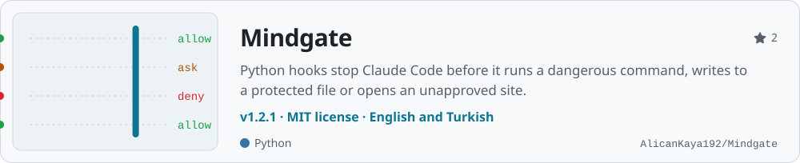
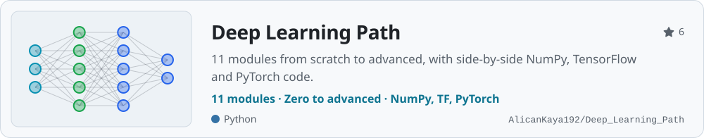
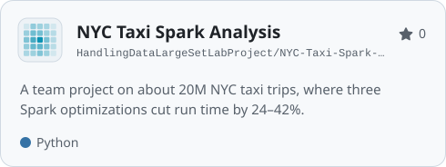
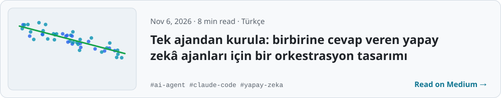
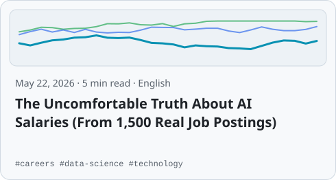

<a href="https://alican-kaya.com">
  <picture>
    <source media="(prefers-color-scheme: dark)" srcset="https://raw.githubusercontent.com/AlicanKaya192/alicankaya192/main/assets/header-dark.svg">
    
  </picture>
</a>

  <a href="https://alican-kaya.com"><b>Website</b></a>&nbsp;&nbsp;·&nbsp;&nbsp;
  <a href="https://www.linkedin.com/in/alicankaya192"><b>LinkedIn</b></a>&nbsp;&nbsp;·&nbsp;&nbsp;
  <a href="https://medium.com/@alicankaya268"><b>Medium</b></a>&nbsp;&nbsp;·&nbsp;&nbsp;
  <a href="mailto:alicankaya268@gmail.com"><b>Email</b></a>

  

## About

I study computer science and work on data science, machine learning and the software around them. My projects range from a 22-module roadmap and an offline desktop app to a team Spark analysis of about 20 million NYC taxi trips.

- [Odyssey](https://github.com/AlicanKaya192/Odyssey) and [Mindgate](https://github.com/AlicanKaya192/Mindgate) are what I'm building now: one teaches ML offline, the other adds safety checks to Claude Code.
- Most of my work is machine learning, deep learning and exploratory data analysis in Python, plus application development with C# and .NET.
- I write about data and AI on [Medium](https://medium.com/@alicankaya268), from AI salaries in 1,500 job postings to the 2025 World Happiness Report.

## Featured work

  <a href="https://github.com/AlicanKaya192/Odyssey"><picture><source media="(prefers-color-scheme: dark)" srcset="https://raw.githubusercontent.com/AlicanKaya192/alicankaya192/main/assets/card-odyssey-dark.svg"></picture></a>
  <a href="https://github.com/AlicanKaya192/Mindgate"><picture><source media="(prefers-color-scheme: dark)" srcset="https://raw.githubusercontent.com/AlicanKaya192/alicankaya192/main/assets/card-mindgate-dark.svg"></picture></a>
  <a href="https://github.com/AlicanKaya192/Data-Science-RoadMap"><picture><source media="(prefers-color-scheme: dark)" srcset="https://raw.githubusercontent.com/AlicanKaya192/alicankaya192/main/assets/card-data-science-roadmap-dark.svg"></picture></a>

  <a href="https://github.com/AlicanKaya192/Deep_Learning_Path"><picture><source media="(prefers-color-scheme: dark)" srcset="https://raw.githubusercontent.com/AlicanKaya192/alicankaya192/main/assets/card-deep_learning_path-dark.svg"></picture></a>
  <a href="https://github.com/AlicanKaya192/AI-Jobs-Market-2025-2026-Salaries"><picture><source media="(prefers-color-scheme: dark)" srcset="https://raw.githubusercontent.com/AlicanKaya192/alicankaya192/main/assets/card-ai-jobs-market-2025-2026-salaries-dark.svg"></picture></a>
  <a href="https://github.com/HandlingDataLargeSetLabProject/NYC-Taxi-Spark-Analysis"><picture><source media="(prefers-color-scheme: dark)" srcset="https://raw.githubusercontent.com/AlicanKaya192/alicankaya192/main/assets/card-nyc-taxi-spark-analysis-dark.svg"></picture></a>
  <a href="https://github.com/AlicanKaya192/CS_Complete_Terminology_Guide"><picture><source media="(prefers-color-scheme: dark)" srcset="https://raw.githubusercontent.com/AlicanKaya192/alicankaya192/main/assets/card-cs_complete_terminology_guide-dark.svg"></picture></a>

<a href="https://github.com/AlicanKaya192?tab=repositories">All repositories →</a>

## Latest writing

Topics range from Claude Code agents to salary data and prompt injection.

<!-- MEDIUM:START -->

  <a href="https://medium.com/@alicankaya268/i-gave-claude-code-a-memory-and-put-guards-in-front-of-it-91d9b40238f4"><picture><source media="(prefers-color-scheme: dark)" srcset="https://raw.githubusercontent.com/AlicanKaya192/alicankaya192/main/assets/post-1-dark.svg?v=91d9b40238f4"></picture></a>
  <a href="https://medium.com/@alicankaya268/tek-ajandan-kurula-birbirine-cevap-veren-yapay-zek%C3%A2-ajanlar%C4%B1-i%C3%A7in-bir-orkestrasyon-tasar%C4%B1m%C4%B1-d4f0c6856f4e"><picture><source media="(prefers-color-scheme: dark)" srcset="https://raw.githubusercontent.com/AlicanKaya192/alicankaya192/main/assets/post-2-dark.svg?v=d4f0c6856f4e"></picture></a>
  <a href="https://medium.com/@alicankaya268/the-uncomfortable-truth-about-ai-salaries-from-1-500-real-job-postings-19ac76bd6f53"><picture><source media="(prefers-color-scheme: dark)" srcset="https://raw.githubusercontent.com/AlicanKaya192/alicankaya192/main/assets/post-3-dark.svg?v=19ac76bd6f53"></picture></a>
  <a href="https://medium.com/@alicankaya268/i-analyzed-the-2025-world-happiness-report-heres-what-the-data-actually-shows-1ca8716036ae"><picture><source media="(prefers-color-scheme: dark)" srcset="https://raw.githubusercontent.com/AlicanKaya192/alicankaya192/main/assets/post-4-dark.svg?v=1ca8716036ae"></picture></a>
  <a href="https://medium.com/@alicankaya268/prompt-injection-the-invisible-threat-in-the-age-of-artificial-intelligence-7a5fbe84fad2"><picture><source media="(prefers-color-scheme: dark)" srcset="https://raw.githubusercontent.com/AlicanKaya192/alicankaya192/main/assets/post-5-dark.svg?v=7a5fbe84fad2"></picture></a>

<!-- MEDIUM:END -->

<a href="https://medium.com/@alicankaya268">All posts on Medium →</a>

## Toolkit

<picture>
  <source media="(prefers-color-scheme: dark)" srcset="https://raw.githubusercontent.com/AlicanKaya192/alicankaya192/main/assets/stack-dark.svg">
  
</picture>

---

  If you're building something with data or ML and want a collaborator, I'd like to hear about it: <a href="mailto:alicankaya268@gmail.com">alicankaya268@gmail.com</a>

