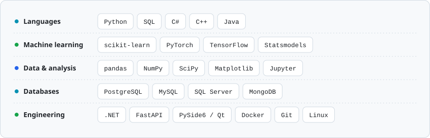
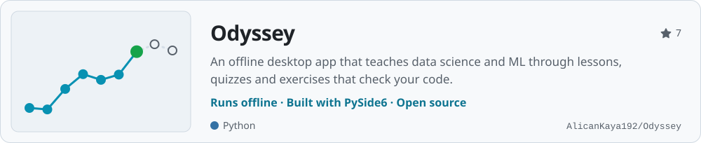
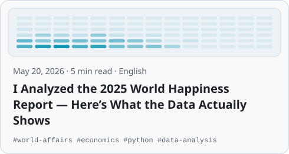
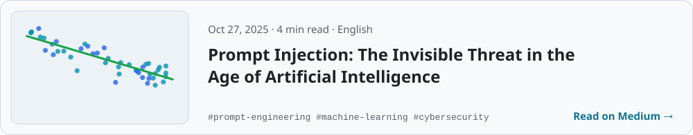

<a href="https://alican-kaya.com">
  <picture>
    <source media="(prefers-color-scheme: dark)" srcset="https://raw.githubusercontent.com/AlicanKaya192/alicankaya192/main/assets/header-dark.svg?v=404763a70c">
    
  </picture>
</a>

  <a href="https://alican-kaya.com"><b>Website</b></a>&nbsp;&nbsp;·&nbsp;&nbsp;
  <a href="https://www.linkedin.com/in/alicankaya192"><b>LinkedIn</b></a>&nbsp;&nbsp;·&nbsp;&nbsp;
  <a href="https://medium.com/@alicankaya268"><b>Medium</b></a>&nbsp;&nbsp;·&nbsp;&nbsp;
  <a href="mailto:alicankaya268@gmail.com"><b>Email</b></a>

  

## About

I'm a computer science undergraduate in Türkiye, and my goal is to become a good AI engineer. I like taking a messy dataset and following it through to a clear answer. I turn what I learn into open resources in Turkish and English, and I write about data and AI on [Medium](https://medium.com/@alicankaya268).

- Data science, ML and software overlap in my work. Python handles data and models, C# and .NET the apps.
- I build with Claude Code, and I wrote my own tool to limit what AI assistants can do on a computer.
- If you have a data science or ML project in mind, I'm open to working on it together.

## Toolkit

<picture>
  <source media="(prefers-color-scheme: dark)" srcset="https://raw.githubusercontent.com/AlicanKaya192/alicankaya192/main/assets/stack-dark.svg?v=ef8fa3fafc">
  
</picture>

## Featured work

<!-- PROJECTS:START -->

  <a href="https://github.com/AlicanKaya192/Odyssey"><picture><source media="(prefers-color-scheme: dark)" srcset="https://raw.githubusercontent.com/AlicanKaya192/alicankaya192/main/assets/card-odyssey-dark.svg?v=2d40092b0e"></picture></a>
  <a href="https://github.com/AlicanKaya192/Mindgate"><picture><source media="(prefers-color-scheme: dark)" srcset="https://raw.githubusercontent.com/AlicanKaya192/alicankaya192/main/assets/card-mindgate-dark.svg?v=cb0648410f"></picture></a>
  <a href="https://github.com/AlicanKaya192/Data-Science-RoadMap"><picture><source media="(prefers-color-scheme: dark)" srcset="https://raw.githubusercontent.com/AlicanKaya192/alicankaya192/main/assets/card-data-science-roadmap-dark.svg?v=f35124e168"></picture></a>
  <a href="https://github.com/AlicanKaya192/Deep_Learning_Path"><picture><source media="(prefers-color-scheme: dark)" srcset="https://raw.githubusercontent.com/AlicanKaya192/alicankaya192/main/assets/card-deep_learning_path-dark.svg?v=57d8a7de7a"></picture></a>
  <a href="https://github.com/AlicanKaya192/AI-Jobs-Market-2025-2026-Salaries"><picture><source media="(prefers-color-scheme: dark)" srcset="https://raw.githubusercontent.com/AlicanKaya192/alicankaya192/main/assets/card-ai-jobs-market-2025-2026-salaries-dark.svg?v=f150149d1b"></picture></a>
  <a href="https://github.com/HandlingDataLargeSetLabProject/NYC-Taxi-Spark-Analysis"><picture><source media="(prefers-color-scheme: dark)" srcset="https://raw.githubusercontent.com/AlicanKaya192/alicankaya192/main/assets/card-nyc-taxi-spark-analysis-dark.svg?v=07af8d2649"></picture></a>
  <a href="https://github.com/AlicanKaya192/CS_Complete_Terminology_Guide"><picture><source media="(prefers-color-scheme: dark)" srcset="https://raw.githubusercontent.com/AlicanKaya192/alicankaya192/main/assets/card-cs_complete_terminology_guide-dark.svg?v=b9b1a1a6c1"></picture></a>

<!-- PROJECTS:END -->

<a href="https://github.com/AlicanKaya192?tab=repositories">All repositories →</a>

## Latest writing

Topics range from Claude Code agents to salary data and prompt injection.

<!-- MEDIUM:START -->

  <a href="https://medium.com/@alicankaya268/i-gave-claude-code-a-memory-and-put-guards-in-front-of-it-91d9b40238f4"><picture><source media="(prefers-color-scheme: dark)" srcset="https://raw.githubusercontent.com/AlicanKaya192/alicankaya192/main/assets/post-1-dark.svg?v=4fdd7a5ab9"></picture></a>
  <a href="https://medium.com/@alicankaya268/tek-ajandan-kurula-birbirine-cevap-veren-yapay-zek%C3%A2-ajanlar%C4%B1-i%C3%A7in-bir-orkestrasyon-tasar%C4%B1m%C4%B1-d4f0c6856f4e"><picture><source media="(prefers-color-scheme: dark)" srcset="https://raw.githubusercontent.com/AlicanKaya192/alicankaya192/main/assets/post-2-dark.svg?v=368d46e52e"></picture></a>
  <a href="https://medium.com/@alicankaya268/the-uncomfortable-truth-about-ai-salaries-from-1-500-real-job-postings-19ac76bd6f53"><picture><source media="(prefers-color-scheme: dark)" srcset="https://raw.githubusercontent.com/AlicanKaya192/alicankaya192/main/assets/post-3-dark.svg?v=bc9f7ebdd3"></picture></a>
  <a href="https://medium.com/@alicankaya268/i-analyzed-the-2025-world-happiness-report-heres-what-the-data-actually-shows-1ca8716036ae"><picture><source media="(prefers-color-scheme: dark)" srcset="https://raw.githubusercontent.com/AlicanKaya192/alicankaya192/main/assets/post-4-dark.svg?v=18f9eab3c1"></picture></a>
  <a href="https://medium.com/@alicankaya268/prompt-injection-the-invisible-threat-in-the-age-of-artificial-intelligence-7a5fbe84fad2"><picture><source media="(prefers-color-scheme: dark)" srcset="https://raw.githubusercontent.com/AlicanKaya192/alicankaya192/main/assets/post-5-dark.svg?v=ce14b8e946"></picture></a>

<!-- MEDIUM:END -->

<a href="https://medium.com/@alicankaya268">All posts on Medium →</a>

---

  If you're building something with data or ML and want a collaborator, I'd like to hear about it: <a href="mailto:alicankaya268@gmail.com">alicankaya268@gmail.com</a>

